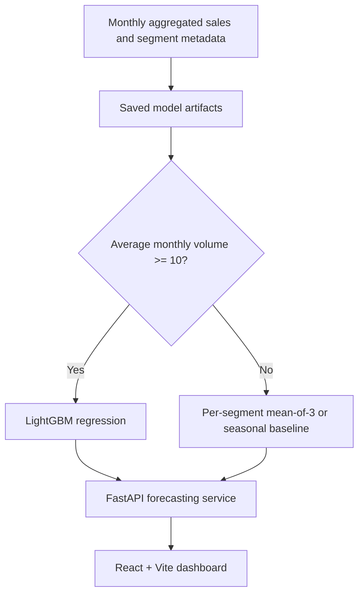

# VIVAIA Demand Forecasting

**A deployed retail demand-forecasting case study:** predict monthly unit sales by country and product category using a hybrid approach that handles both frequent and sparse demand.

[**Live dashboard**](https://vivaia-demand-forecasting.vercel.app) · [**FastAPI docs**](https://vivaia-demand-forecasting.onrender.com/docs) · [**Run locally**](RUN_LOCAL.md) · [**Validation notes**](docs/model-validation.md)

> **Scope:** This is a portfolio forecasting application, not a claim of an official VIVAIA production deployment or business partnership. The saved model and historical data are snapshots; forecasts should not be used as operational inventory decisions without further validation.

## Why this project?

Retail demand varies across markets and product categories. A single forecasting method can be a poor fit when some product segments sell in substantial volumes while others have few observations. This project routes each segment to a model family appropriate for its historical volume and exposes the result through an interactive web app.

### What you can explore

- Filter by **country**, **product category**, and **forecast month**.
- See historical monthly sales alongside a forecast.
- Inspect which model generated the prediction: **LightGBM** for higher-volume segments or a **simple baseline** for sparse-demand segments.
- Review stored walk-forward backtest results through the dashboard and API.

## Architecture



| Component | Implementation |
| --- | --- |
| Forecasting | LightGBM, pandas, NumPy, scikit-learn |
| API | Python 3.11, FastAPI, Pydantic, Uvicorn |
| Dashboard | React 18, Vite, Tailwind CSS, Recharts |
| Hosting | Render (Docker backend), Vercel (static frontend) |
| Artifacts | Serialized LightGBM model, feature schema, routing and historical CSV files |

## Dataset and model design

- **Forecast target:** `total_pcs` (monthly units sold) for each `country_code × category` segment.
- **Coverage:** 500 segments in the saved routing table — **397 high-volume** and **103 low-volume**.
- **Available historical series:** January 2024–December 2025 in the project description; the saved feature schema specifies an ML **training window of April 2024–December 2025**.
- **Model inputs:** 23 columns listed in [`feature_schema.json`](backend/models/feature_schema.json), including calendar/seasonality, lags, rolling sales statistics, prior price and discount signals, and assortment indicators.
- **Routing rule:** average monthly volume at least 10 units → LightGBM; otherwise → a segment-specific mean-of-last-three-months or seasonal baseline.

The original project description references roughly **2 million source transactions** before aggregation. This repository distributes aggregated series and trained artifacts; it does **not** currently provide the original transaction-level data or a complete, executable training pipeline.

## Evaluation

Saved results in [`backtest_results.json`](backend/models/backtest_results.json) record **six walk-forward folds**:

| Segment population | Forecast method | MAE (units) | RMSE (units) | sMAPE |
| --- | --- | ---: | ---: | ---: |
| High-volume | LightGBM | 92.74 | 549.28 | 45.58% |
| Low-volume | Selected baseline | 3.32 | 4.65 | 59.77% |

**Important:** These methods are evaluated on **different demand populations**. The MAE and RMSE values are *not* a head-to-head comparison or proof that the hybrid approach outperforms a single method. Read [validation, limitations and next experiments](docs/model-validation.md) for the methodology and caveats.

## Run locally

**Prerequisites:** Python 3.11, Node.js 18+, and npm.

Backend (from the repository root):

```bash
cd backend
python3 -m venv .venv
source .venv/bin/activate
pip install -r requirements.txt
uvicorn app.main:app --reload --port 8000
```

In a second terminal:

```bash
cd frontend
npm install
cp .env.example .env.local
npm run dev
```

Set `VITE_API_BASE=http://127.0.0.1:8000` in `frontend/.env.local`. Visit **http://localhost:5173**; the local API documentation is at **http://127.0.0.1:8000/docs**.

For details and troubleshooting, see [RUN_LOCAL.md](RUN_LOCAL.md).

## API

| Method | Route | Purpose |
| --- | --- | --- |
| GET | `/` | Service health |
| GET | `/segments` | Available country/category combinations |
| GET | `/history/{country_code}/{category}` | Monthly historical units |
| POST | `/predict` | Single forecast and selected model metadata |
| GET | `/backtest_summary` | Saved validation summary |

Example request against a locally running API:

```bash
curl -X POST http://127.0.0.1:8000/predict \
  -H "Content-Type: application/json" \
  -d '{"country_code":"US","category":"CAT_005","target_month":"2026-01"}'
```

## Deployment

The services are hosted separately:

1. **Render:** deploy the `backend/` directory as a Docker web service using `backend/Dockerfile`. The container loads artifacts from `backend/models/`. Free instances may sleep when idle.
2. **Vercel:** deploy `frontend/` as a Vite app and set the **build-time** variable `VITE_API_BASE` to `https://vivaia-demand-forecasting.onrender.com`. Redeploy after changing the variable.

For a public production API, restrict `CORS_ORIGINS` to your frontend's origin rather than relying on the development default of `*`.

## Repository map

```text
backend/
  app/                   # FastAPI routes and forecasting service
  models/                # Saved model, routing and aggregated history
  Dockerfile
  requirements.txt
frontend/
  src/                   # Dashboard, charts and API client
  package.json
docs/
  model-validation.md    # Evaluation evidence and limitations
RUN_LOCAL.md
```

## Known limitations and next steps

- **Forecast horizon:** LightGBM inference reuses the latest saved lag/rolling features. The implementation is intended for **one-month-ahead forecasting**; later months are accepted but flagged as potentially less reliable.
- **Static snapshots:** Model and history artifacts are not refreshed automatically. There is currently no retraining workflow included.
- **Evidence:** A meaningful next experiment is a **matched-sample** comparison against uniform seasonal and rolling-mean baselines, with business-relevant segmentation and prediction intervals.
- **Data governance:** Confirm redistribution rights for the provided aggregated data and model artifacts before treating them as public-domain assets.

---

**Project:** Independent demand-forecasting case study · **Author:** Sudhanshu Dubey

**Links:** [GitHub](https://github.com/sudhanshudubey/vivaia-demand-forecasting) · [Dashboard](https://vivaia-demand-forecasting.vercel.app)
